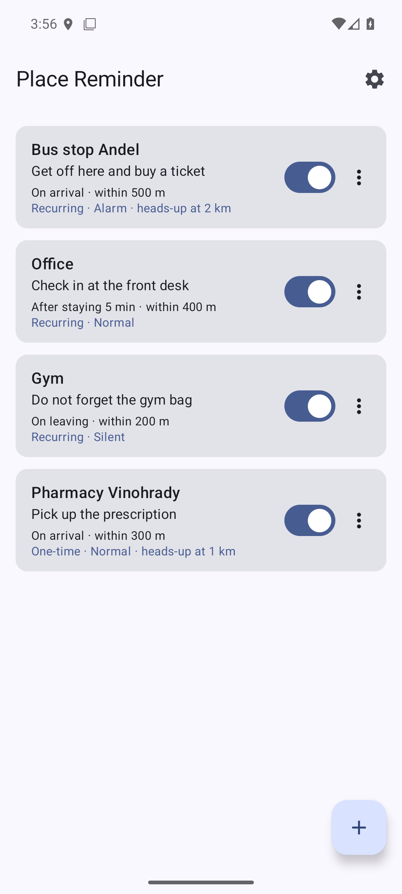
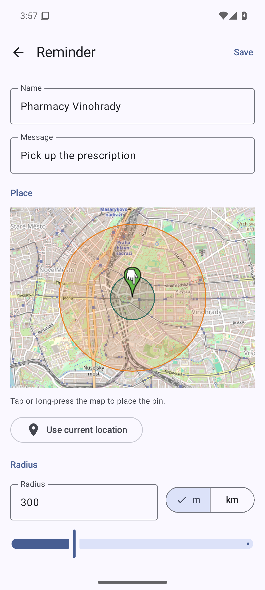
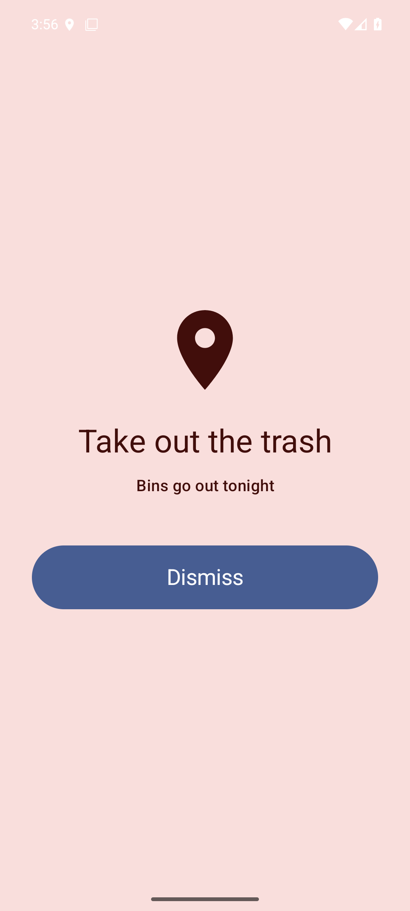

# Place Reminder

An Android app that reminds you when you arrive at, leave, or stay at a place. It uses geofencing, so it does not poll your location. Maps come from OpenStreetMap. No account, no tracking, and nothing leaves your phone.

**Download:** [place-reminder.apk](https://github.com/janhorak58/place-reminder/releases/latest/download/place-reminder.apk) (all versions on the [releases page](https://github.com/janhorak58/place-reminder/releases)). Project site: https://janhorak58.github.io/place-reminder/

| List | Editor | Alarm |
|---|---|---|
|  |  |  |

## Features

- Triggers: Enter, Exit, or Stay (dwell for a set number of minutes)
- One-time or recurring reminders
- Heads-up alert before you arrive, useful when driving
- Three notification levels: Silent, Normal, Alarm (full-screen, looping sound until dismissed)
- Radius from 50 m to 50 km, set on an OpenStreetMap map
- Battery-friendly: uses the system geofencing API

## Install

1. Download the APK on your phone from the link above.
2. Allow "Install unknown apps" for your browser or file app when asked.
3. Open the APK and install.
4. Grant the permissions below when the app asks.

## Permissions

- **Location, "Allow all the time":** geofences must fire while the app is closed.
- **Notifications:** to show reminders.
- **Full-screen alerts:** so Alarm reminders can appear over the lock screen.

## Build from source

```
./gradlew assembleRelease
```

The signed APK is copied to `dist/place-reminder-<versionName>.apk`. Signing reads `~/.android/place_reminder.keystore.properties` with these keys:

```
storeFile=/path/to/keystore
storePassword=...
keyAlias=...
keyPassword=...
```

If the file is missing, the build falls back to an unsigned release.

## Requirements

- Android 10 (API 29) or newer
- Google Play Services (for the geofencing API)

Alerts can arrive up to about a minute late, and radii under 100 m are unreliable.

## License

[MIT](LICENSE)
